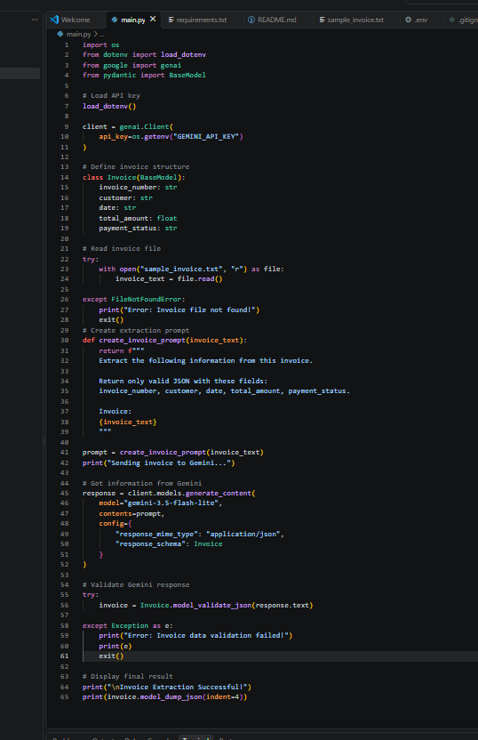
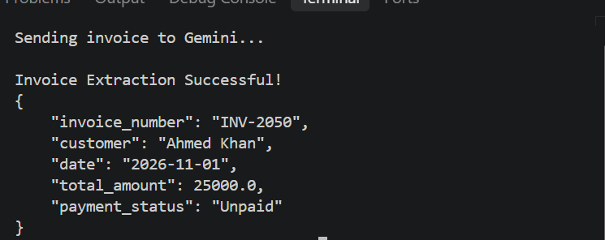

<h1 align="center">⚡ Structured LLM Prompt Pipeline & JSON Extractor</h1>

<p align="center">
  <strong>Turning Unstructured Invoice Text into Structured Data with Generative AI</strong>
</p>

<p align="center">
  
  
  
  
  
</p>

---

## 🚀 About the Project

This project is an AI-powered invoice information extraction system developed using Python and Google's Gemini API.

It takes unstructured invoice text as input, sends it to Gemini using a reusable prompt, and extracts important information into a structured JSON format.

The extracted response is validated using Pydantic to ensure that the required fields follow the expected data structure.

**Main Goal:** Demonstrate how Large Language Models (LLMs) can automate information extraction and produce structured data.

## ✨ Key Features

- 🤖 **Generative AI Integration** — Connects Python with Google Gemini.
- 📝 **Reusable Prompt Pipeline** — Uses a parameterized function to create prompts.
- 📄 **Invoice Text Processing** — Reads invoice information from a text file.
- 📦 **Structured JSON Extraction** — Extracts predefined invoice fields.
- 🛡️ **Pydantic Validation** — Validates the AI-generated JSON response.
- 🔐 **Environment Variables** — Keeps API credentials outside the source code.
- ⚠️ **Basic Error Handling** — Handles missing input files and invalid response data.

## 🧰 Technology Stack

| Technology          | Purpose                              |
|:--------------------|:-------------------------------------|
| Python              | Application development              |
| Google Gemini API   | AI-based information extraction      |
| Google GenAI SDK    | Gemini API connection                |
| Pydantic            | Data validation                       |
| JSON                | Structured output                     |
| python-dotenv       | Environment variable management      |

## 🔄 System Workflow

```text
       📄 Invoice Text File
                |
                ▼
       🐍 Python Application
                |
                ▼
       🧠 Reusable Prompt
                |
                ▼
        🤖 Google Gemini API
                |
                ▼
        📦 JSON Response
                |
                ▼
       🛡️ Pydantic Validation
                |
                ▼
         ✅ Final Output
```

## 📁 Project Structure

```text
Datheon_Python_Generative_AI_LangChain_Internship/
│
└── Task-1/
    │
    ├── main.py
    ├── sample_invoice.txt
    ├── requirements.txt
    ├── README.md
    ├── .env.example
    ├── .gitignore
    │
    └── screenshots/
        ├── task1_code.png
        └── task1_output.png
```

## ⚙️ Installation & Setup

### 1. Clone the Repository

```bash
git clone https://github.com/musadiq-qureshi/Datheon_Python_Generative_AI_LangChain_Internship.git
```

### 2. Navigate to Task-1

```bash
cd Datheon_Python_Generative_AI_LangChain_Internship/Task-1
```

### 3. Install Dependencies

```bash
pip install -r requirements.txt
```

### 4. Configure Gemini API Key

Create a `.env` file inside the `Task-1` folder.

Add your own Gemini API key:

```env
GEMINI_API_KEY=your_gemini_api_key_here
```

Replace the placeholder with your own key.

### 5. Run the Application

```bash
python main.py
```

## 📸 Project Screenshots

### 1. Python Source Code

This screenshot shows the Python implementation, Gemini integration, reusable prompt, and Pydantic validation.



**Screenshot file:** `screenshots/task1_code.png`

### 2. Successful JSON Output

This screenshot demonstrates the successful extraction of invoice information into structured JSON.



**Screenshot file:** `screenshots/task1_output.png`

## 📊 Sample JSON Result

```json
{
    "invoice_number": "INV-2050",
    "customer": "Ahmed Khan",
    "date": "2026-11-01",
    "total_amount": 25000.0,
    "payment_status": "Unpaid"
}
```

## 🎓 What I Learned

- Python programming and file handling.
- Connecting applications with Generative AI APIs.
- Creating reusable and parameterized prompts.
- Working with Large Language Models.
- Extracting structured information using AI.
- Handling JSON responses.
- Validating data with Pydantic.
- Managing API keys securely.

## 🔐 Security & Privacy

- The real `.env` file must never be uploaded to GitHub.
- API credentials are loaded through environment variables.
- `.gitignore` excludes the `.env` file.
- `.env.example` contains only a placeholder.
- Sample invoice information is used for demonstration.

**Never share your private Gemini API key publicly.**

# 🏆 Datheon AI & ML Internship

## 🚀 Structured LLM Prompt Pipeline & JSON Extractor

**Internship Task 1 | Generative AI**

A Python-based Generative AI project that uses Google Gemini AI to process structured prompts and extract information into well-formatted JSON outputs.

---


# 🏆 Internship Details

| Detail | Information |
|:---|:---|
| Organization | Datheon |
| Program | AI & ML Internship |
| Task | Task 1 |
| Project Category | Generative AI |
| Project Title | Structured LLM Prompt Pipeline & JSON Extractor |

---

# 👨‍💻 Developer

### Musadiq Mehmood Qureshi

<p>
  <a href="https://github.com/musadiq-qureshi">
    
  </a>
  <a href="https://www.linkedin.com/in/musadiq-qureshi-32271936a">
    
  </a>
</p>

💡 Focused on writing clean, efficient Python code and developing practical AI-powered applications.

---

### ⚡ Technology

**Built with Python | Powered by Google Gemini AI**

---

⭐ **Thanks for visiting my repository!**
